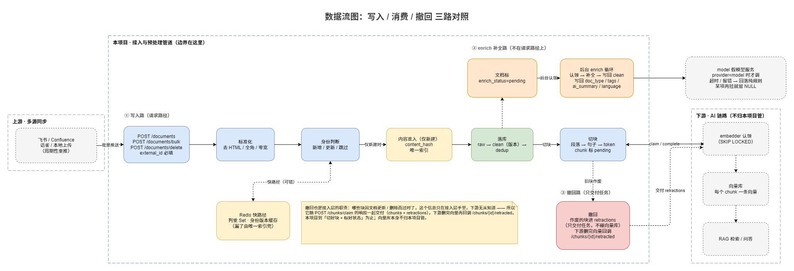
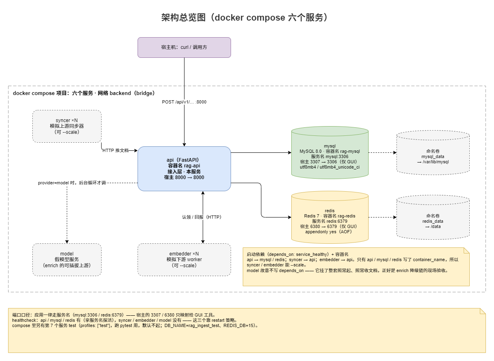
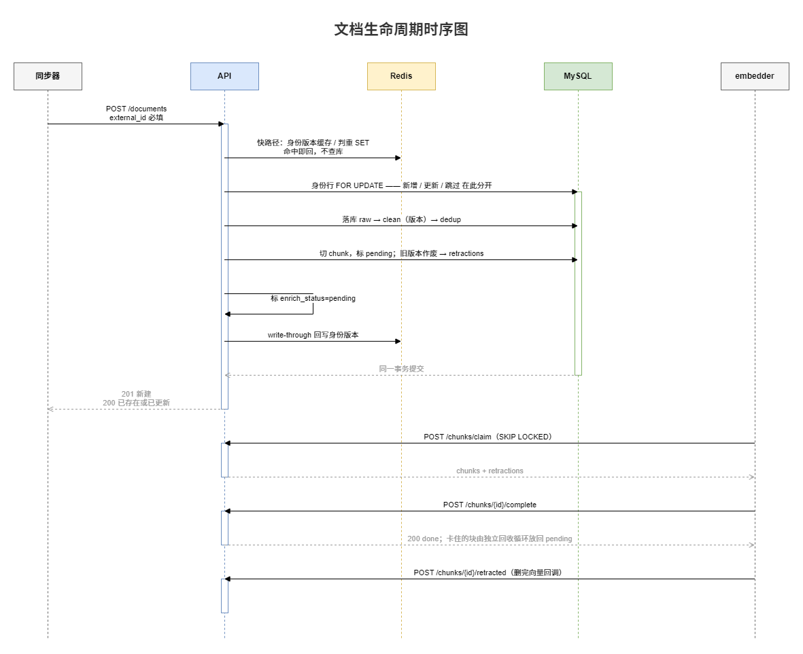
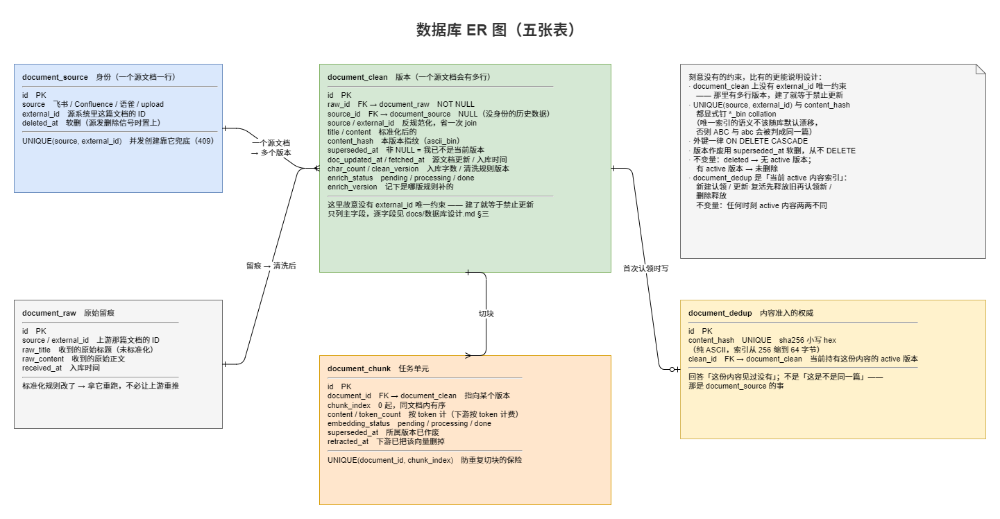

# 企业知识库 RAG 数据接入与预处理管道

> 多个同步器（飞书 / Confluence / 语雀 / 本地上传）把文档推进来，管道负责
> **标准化 → 内容去重 → 落库 → 切块 → 派发向量化任务**，
> 为下游的向量检索 / RAG 提供干净、切好块、带状态的数据。

**去重挡掉重复同步 —— 省的是按量计费的 embedding 调用。**

---

## 要解决的问题

企业知识库的数据是这么进来的：

- **多源**：同一份文档往往同时挂在飞书和 Confluence 上，两个同步器都会推过来；
- **反复同步**：同步器按周期跑，**文档没变也会再推一遍**；
- **体量大**：一次全量同步可能来几千篇，每篇要切块、每块要向量化。

不做处理，下游就会收到大量重复文档，**把同一份内容反复切块、反复调 embedding**。

本服务就是接入层：接收 → 标准化 → 内容去重 → 落库 → 切块 → 标记待向量化；
对外提供文档 / 分块查询，以及给下游 worker 的**任务认领**接口。
**两个核心指标**：去重率（挡掉多少重复同步）、向量化积压（还有多少 chunk 没处理）。



---

## 快速开始

> 只在 `docker compose` 里跑，**宿主不需要装 MySQL / Redis / Python**；前提是 Docker Desktop 已在运行。
> 首次 `--build` 要装依赖 + 预热 tiktoken 词表与 jieba 词典，慢几分钟，之后就快。
> 命令都给了两版（Windows 在前），**两种 shell 里一样的就只写一行**。

### 1. 准备配置

```text
# Windows（cmd）
copy .env.example .env

# PowerShell / Git Bash / WSL / macOS
cp .env.example .env
```

### 2. 起服务

```bash
docker compose up -d --build
docker compose ps          # 期望：api / mysql / redis 是 healthy，其余 Up
```

六个容器：`api`（本服务）、`mysql` / `redis`、`syncer`（模拟上游）、`embedder`（模拟下游 worker）、
`model`（假模型服务，enrich 的替身上游）。



### 3. 发一篇文档

样例 JSON 就在仓库里（`scripts/example-doc.json`）。**走文件、别把 JSON 内联进命令行** ——
中文不过命令行就不会被转码（Windows 上这两个都踩过坑）。

```text
# Windows（cmd / PowerShell）—— 就一行，注意是 curl.exe
curl.exe -s -i -X POST http://localhost:8000/api/v1/documents -H "Content-Type: application/json" --data-binary "@scripts/example-doc.json"
# 期望：最上面一行是 HTTP/1.1 201

# Git Bash / WSL / macOS
curl -s -w '\n%{http_code}\n' -X POST http://localhost:8000/api/v1/documents \
  -H 'Content-Type: application/json' --data-binary @scripts/example-doc.json
# 期望：末尾一行是 201
```

### 4. 看流水线跑起来

```bash
docker compose logs -f syncer embedder
```

同步器在按周期推文档、worker 在并发认领 chunk —— 这就是"上游重推 → 去重挡住 → 下游按状态干活"的现场。

### 5. 查库

两个包装是一对，**都不必输口令**，也没有那句 "insecure" 警告：

```text
# Windows（cmd / PowerShell；PowerShell 里写 .\scripts\mysql.cmd）
scripts\mysql.cmd "select count(*) from document_clean;"

# Git Bash / WSL / macOS
bash scripts/mysql.sh "select count(*) from document_clean;"
```

### 6. 跑测试

```bash
docker compose --profile test run --rm test
```

> 更细的逐步验收（每一步"应该看到什么"）、常见症状、Windows 上的 shell 差异，
> 都在 `docs/README-旧版.md`（本地留存，未入库）。

---

## 接口一览

| 方法 | 路径 | 作用 |
|---|---|---|
| POST | `/api/v1/documents` | 提交单篇（`external_id` 必填）。新建 `201`；内容没变 `200`；同 id 改了内容 `200`；内容撞车 `409` |
| POST | `/api/v1/documents/bulk` | 批量提交（同步器的真实调用方式，一次 ≤200 篇） |
| POST | `/api/v1/documents/delete` | 删除信号（按 `source + external_id`，**幂等**，恒 `200`） |
| GET | `/api/v1/documents` | 分页查询（`page/limit/source/q`），走缓存 |
| GET | `/api/v1/documents/{id}` | 单篇详情 |
| GET | `/api/v1/documents/{id}/chunks` | 分块列表（分页） |
| GET | `/api/v1/documents/stats` | 文档数 / 按来源 top10 / 今日新增 / 去重计数 / chunk 状态分布 |
| POST | `/api/v1/chunks/claim` | 下游 worker **认领**待向量化的 chunk（`SKIP LOCKED`，可并发抢） |
| POST | `/api/v1/chunks/{id}/complete` | worker 上报完成 |

> **「重复」不是错误**：同步器周期性地跑，文档没变也会重推 —— 所以语义是"已存在，跳过"（`200`），
> 同步器不必把正常同步当异常处理。



---

## 设计要点

### 1. 双层去重：Redis 快路径 + MySQL 唯一索引做权威

**做了什么**：提交时先问 Redis Set（挡掉绝大多数重复），真正入库时由
`document_dedup.content_hash` 的唯一索引兜底。

**为什么不能只留一层**：Redis 会被清空 / 淘汰 / 重启丢数据，**不能当真相**；
而每次都查库，在同步洪峰下又太贵。两层分工 —— 快路径省往返，唯一索引管正确性
（Redis 说"见过"而库里没有时会自愈）。

**为什么值得做两层**：去重挡掉的不只是数据库往返，更是下游**按量计费**的 embedding 调用。

### 2. 内容指纹 ≠ 文档身份

**做了什么**：指纹是 `sha256(标题 + 正文)`；"这是不是同一篇"由另一张表回答 ——
`document_source` 存 `(source, external_id)` 唯一，`document_clean` 是**版本表**
（`superseded_at` 标出当前版本），更新 / 删除时还要**通知下游撤回**哪些块（`retracted_at`）。

**为什么一个键不够**：指纹只回答"这份内容见过没"。改了标题就换了指纹，同一篇的更新拦不住；
反过来，两篇不同的文档也可能内容一样，会把新文档误判成重复。



### 3. 任务分发用 `SKIP LOCKED`，不是分布式锁；而且必须有超时回收

**做了什么**：`/chunks/claim` 用 `SELECT ... FOR UPDATE SKIP LOCKED` 认领一批 chunk 并置 `processing`。

**为什么不是锁**：锁回答的是"这件事只能一个人做"（保护临界区），
`SKIP LOCKED` 回答的是"这堆活大家分着做"（分发任务）—— 向量化是后者。

**为什么一定要回收**：worker 领完任务然后崩了，那条就永远卡在 `processing`、没人再碰它。
所以既要有回收循环（超时放回 `pending`），也要有"已作废的块不再认领"的过滤 ——
不给已经不要的数据白花 embedding 钱。

### 4. 切块按 token 精确控制，不是按字符

**做了什么**：目标块大小按 **token** 定（tiktoken 精确数），切法是递归字符分割（段落 → 句子 → 硬切）+ overlap。

**为什么不按字符**：块大小是由"模型能吃多少 token"决定的，而中文一个字常占 2 个 token ——
"每 500 字切一刀"会让每块的实际长度飘忽，块大小不可控。
overlap 则是为了跨块语义连贯：检索命中一块时，不至于因为切在句子中间而丢上下文。

### 5. AI 接缝可插拔，且 AI 不拦请求路径

**做了什么**：enrich（语言 / 摘要 / 关键词 / 署名）由**后台循环**补，落库时只标 `pending`；
上游可插拔，provider 一个文件一档（`rule` / `model` / `openai_compat` / `off`）。

**为什么不放在请求路径上**：模型是秒级的**外部依赖**，它慢了、挂了都不能让文档进不来。
降级链最终回落到纯 Python 的规则档，文档照常 `201`，那几列稍后补上（或保持规则算出来的值）。

**实测过**：`openai_compat` 这一档接过真的云厂商（DeepSeek），**只改配置、没改代码**。

---

## 技术栈

| 类别 | 选型 |
|---|---|
| Web 框架 | FastAPI · Pydantic v2 |
| 数据库 | MySQL 8（SQLAlchemy 2.0 Async + aiomysql） |
| 迁移 | Alembic（启动时 `upgrade head`，空库首启自动建表） |
| 缓存 / 去重 / 锁 | Redis 7（`redis.asyncio`）：去重快路径、Cache-Aside、分布式锁 |
| 并发原语 | `SKIP LOCKED` 任务分发 · Lua 比对 token 释放锁 · 版本号让缓存失效 |
| 容器 | Docker Compose：api · mysql · redis · syncer · embedder · model |
| 同步 / Worker | httpx（批量推送、认领任务、调模型服务）；`syncer` / `embedder` 可 `--scale` 多实例 |
| AI 增强 | 规则档（py3langid + jieba）或 HTTP 上游（含 OpenAI 兼容协议） |
| 测试 | pytest + pytest-asyncio（真 MySQL + 真 Redis，110 条） |

---

## 目录结构

```
rag-ingest-pipeline/
├── app/
│   ├── main.py                        # FastAPI 入口；lifespan 起停后台循环、释放连接
│   ├── api/
│   │   ├── deps.py                    # 依赖注入：db session / redis / service
│   │   └── v1/
│   │       ├── router.py              # 路由聚合（stats 必须先于 /{id} 注册）
│   │       └── endpoints/
│   │           ├── documents.py       #   提交 / 批量 / 删除 / 查询 / 分块列表
│   │           ├── chunks.py          #   认领 / 上报完成
│   │           └── stats.py           #   统计
│   ├── services/                      # 业务编排（不写 SQL、不碰 HTTP）
│   │   ├── document_service.py        #   标准化 → 加锁 → 判重 → 落库 → 切块 → 派发
│   │   ├── normalize_service.py       #   纯函数：标准化（去 HTML / 全角 / 零宽…）
│   │   ├── chunk_service.py           #   纯函数：切块（段落优先 + overlap）
│   │   ├── dedup_service.py           #   去重快路径（Redis）与计数
│   │   ├── lock_service.py            #   分布式锁（Lua 释放）
│   │   ├── cache_service.py           #   Cache-Aside + 版本号失效
│   │   ├── task_service.py            #   chunk 认领 / 完成（SKIP LOCKED）
│   │   ├── enrich_service.py          #   AI 接缝 facade：分派 provider + 降级链
│   │   ├── enrich_providers/          #   AI 适配层：一个 provider 一个文件
│   │   ├── enricher.py                #   后台补 enrich 的循环
│   │   └── reclaimer.py               #   超时回收循环（chunk + enrich）
│   ├── repositories/                  # 所有 DB 读写（含 SKIP LOCKED 认领）
│   ├── models/                        # ORM 表：raw / clean / dedup / source / chunk
│   ├── schemas/                       # Pydantic 出入参
│   ├── infra/                         # Redis 客户端 / 模型服务的 HTTP 客户端
│   ├── core/                          # 配置 / 日志 / 业务异常与统一映射
│   └── utils/                         # 无状态纯工具（hash / 时间 / 语言 / 关键词 / 切样）
├── syncer/                            # 模拟上游：周期性批量推文档
├── embedder/                          # 模拟下游：认领 chunk 做（模拟）向量化
├── model/                             # 假模型服务（零依赖；enrich 的可插拔上游）
├── alembic/                           # 迁移（异步 engine，DSN 取自配置）
├── assets/diagrams/                   # README 用的图（PNG；可编辑源在本地 docs/diagrams/）
├── scripts/                           # 上游探活、两个查库包装、样例 JSON
├── tests/                             # pytest（真 MySQL + 真 Redis）
└── docker-compose.yml                 # 六个服务 + 网络 + 卷
```

**分层与数据流**：`endpoint → service → repository → DB`；缓存 / 去重 / 锁走 Redis；
调模型服务只发生在**后台循环**里（不在请求路径上）；业务异常在 `core/exceptions.py` 统一映射成响应。
